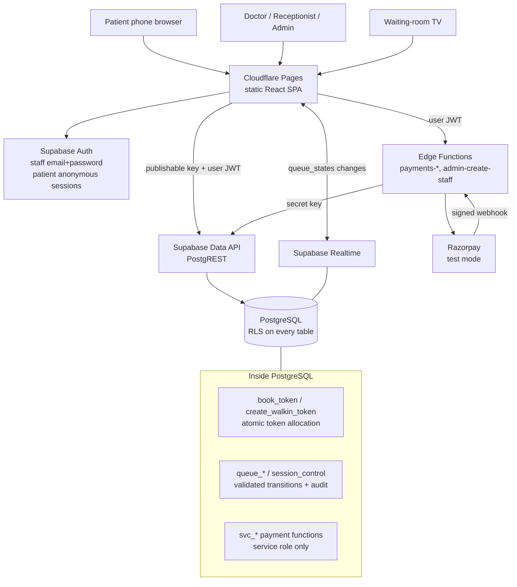

# 1. System architecture

MediQueue is a single-hospital OPD booking, digital token and live queue system. It is a static
React app on Cloudflare Pages talking directly to Supabase (Postgres + Auth + Realtime), with
Supabase Edge Functions only where a server secret is required (payments, staff provisioning).



## Why this shape

| Decision                                                 | Reason                                                                                                                                                                |
| -------------------------------------------------------- | --------------------------------------------------------------------------------------------------------------------------------------------------------------------- |
| Business rules live in PostgreSQL functions              | Token allocation, capacity, duplicates, transitions and the audit entry all commit in **one transaction** under one row lock. No network hop can split them.          |
| Browser calls RPCs with the publishable key              | No server to run or pay for. Every function is `SECURITY DEFINER` with explicit role checks, and every table has RLS.                                                 |
| Edge Functions only for secrets                          | Razorpay `key_secret`, the webhook secret and the Supabase secret key never reach the browser.                                                                        |
| Realtime publishes only `queue_states` and announcements | Neither contains patient data, so anonymous subscribers are safe. Staff screens treat a `queue_states.version` bump as a signal to refetch their RLS-protected lists. |
| Polling fallback                                         | When a Realtime channel is not `SUBSCRIBED` (blocked network, the 200-connection free limit, reconnecting), queries refetch every 15 s.                               |

## Patient identity without OTP

OTP by SMS costs money, so the MVP does not use it. Instead:

1. On the booking page the app creates a **Supabase anonymous session** (free, no PII). It ties
   bookings to the device, enables "My appointments", and gives the database a stable id for
   per-account rate limits.
2. Each booking returns a **booking reference** (`MQ-7K3P9XQ2`) and a **128-bit secret key**. Only
   the SHA-256 hash of the key is stored. The tracking link is `/track/MQ-…#k=<key>`. The key is
   in the URL **fragment**, so it is never sent to Cloudflare or Supabase in request URLs, logs or
   `Referer` headers. It is sent only in the RPC body.
3. Phone number is **never** an access credential. There is no "look up by phone" endpoint.

**Security implications of booking without OTP (accepted for the MVP, documented for the hospital):**

- Anyone can book in someone else's name or phone number. The hospital verifies identity at the
  desk at check-in.
- A bad actor could reserve many tokens. Mitigations: one active token per phone per session,
  N bookings per phone per day, 10 bookings/hour per session, 40/hour per IP, Supabase's
  anonymous sign-in limit (30/hour/IP), and optional Cloudflare Turnstile (free, set
  `VITE_TURNSTILE_SITE_KEY` and Supabase CAPTCHA). The hospital can
  also reserve walk-in tokens per shift.
- A leaked tracking link reveals the token, doctor and time, plus a **masked** name/phone
  (`R*** K****`, `XXXXXX4321`). The owner can rotate the link from "My appointments".
- Upgrading to SMS/WhatsApp OTP later only needs a provider behind the notification interface;
  the booking functions do not change.

## Request paths

| Actor          | Path                                                                                                                             | Auth                       | Guard                                                        |
| -------------- | -------------------------------------------------------------------------------------------------------------------------------- | -------------------------- | ------------------------------------------------------------ |
| Visitor        | `search_doctors`, `get_sessions`, `get_display_board`, tables `doctors`, `departments`, `hospital_announcements`, `queue_states` | none (anon)                | RLS: public rows only; no PII in these objects               |
| Patient        | `book_token`, `get_my_appointments`, `rotate_access_key`                                                                         | anonymous or email session | `auth.uid()` required, rate limits, server validation        |
| Key holder     | `get_booking`, `cancel_booking`                                                                                                  | reference + key (or owner) | key hash match, IP + reference rate limits                   |
| Staff          | `queue_*`, `session_control`, `create_walkin_token`, `queue_stats`, `appointments` select                                        | email + password           | `app.require_doctor_permission` matrix + RLS                 |
| Admin          | config tables, `admin_dashboard`, `request_refund`, `audit_logs`                                                                 | email + password           | `app.is_admin(hospital)` in RLS and functions                |
| Edge Functions | `svc_*`                                                                                                                          | secret key (service_role)  | EXECUTE granted to `service_role` only and re-checked inside |

## Project folder structure

```text
.
├── docs/                         design, API, operations and verification notes
├── public/                       static assets, Cloudflare _headers/_redirects
├── scripts/
│   ├── pg-cluster.mjs            embedded PostgreSQL 17 with all migrations (tests, load tests)
│   ├── create-staff-user.mjs     bootstrap the first admin (uses the secret key locally)
│   └── load/                     concurrency and day-simulation load tests
├── src/
│   ├── api/                      typed Supabase calls (one module per area)
│   ├── auth/                     session provider, staff role guard
│   ├── components/
│   │   ├── ui/                   shadcn/ui primitives
│   │   └── …                     app components (DoctorCard, TokenCard, QueueBoard…)
│   ├── hooks/                    useHospital, useLiveQueue (Realtime + polling)…
│   ├── lib/                      env, supabase client, errors, formatting, validation, transitions
│   ├── pages/
│   │   ├── public/               home, doctors, profile, book, confirmation, track, my bookings
│   │   ├── staff/                login, queue console, walk-in, appointment search
│   │   ├── admin/                dashboard, doctors, schedules, exceptions, staff, payments, audit…
│   │   └── display/              waiting-room TV
│   └── types/                    database row and RPC types
├── supabase/
│   ├── config.toml               local CLI config (functions verify_jwt flags)
│   ├── migrations/               ordered SQL migrations (schema → RLS → logic → payments → grants)
│   ├── seed.sql                  demo hospital, doctors and schedules (no patients)
│   └── functions/
│       ├── _shared/              Razorpay client + signatures, CORS, validation, handlers
│       ├── payments-create-order/
│       ├── payments-verify/
│       ├── payments-webhook/
│       ├── payments-refund/
│       └── admin-create-staff/
└── tests/
    ├── db/                       SQL behaviour, RLS, concurrency, payments (real PostgreSQL)
    ├── unit/                     shared test setup
    └── e2e/                      Playwright (mobile + desktop)
```
