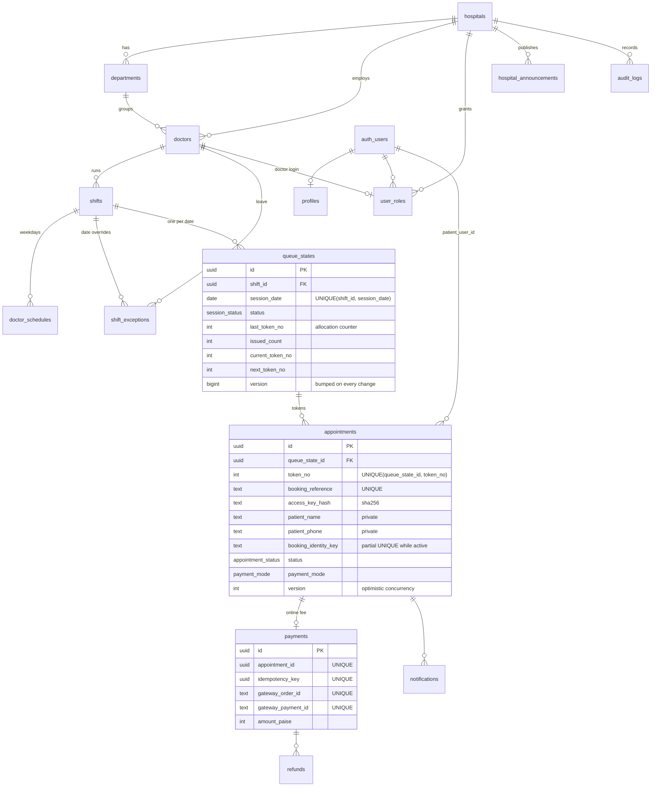
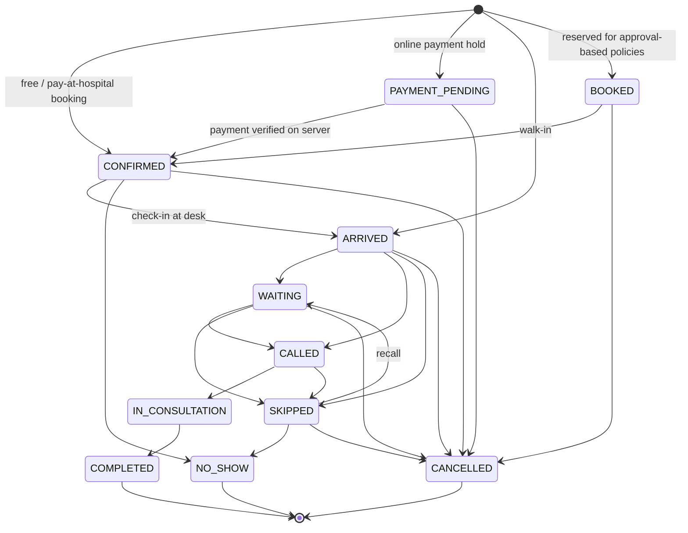

# 2. Database design

Migrations live in [`supabase/migrations`](../supabase/migrations) and are applied in filename order:

| File                                   | Contents                                                                                       |
| -------------------------------------- | ---------------------------------------------------------------------------------------------- |
| `…000100_schema.sql`                   | enums, all tables, constraints, indexes, integrity triggers                                    |
| `…000200_access_control.sql`           | role helpers, rate limiter, RLS policies, table privileges                                     |
| `…000300_booking_and_queue.sql`        | session resolution, atomic booking, tracking, cancellation, queue + session control, dashboard |
| `…000400_payments.sql`                 | payment holds, verification, webhook processing, refunds, housekeeping                         |
| `…000500_function_grants_realtime.sql` | per-function EXECUTE grants, Realtime publication                                              |
| `…000600_staff_provisioning.sql`       | server-only helpers used by the `admin-create-staff` Edge Function                             |
| `…000700_staff_mfa_enforcement.sql`    | role helpers also require an `aal2` token from staff with a verified MFA factor                |

The role helpers (`app.has_role` / `app.is_admin`, `app.is_staff`, `app.can_access_doctor`,
`app.require_doctor_permission`) are what every RLS policy and staff function calls; see
[04-permissions.md](04-permissions.md) for the rules, including two-factor authentication.

Seed data: [`supabase/seed.sql`](../supabase/seed.sql), a fictional hospital and doctors. It has no
patients and no invented qualifications.

## Entity relationship diagram



Tables: `hospitals`, `profiles`, `user_roles`, `departments`, `doctors`, `doctor_schedules`,
`shifts`, `shift_exceptions`, `appointments`, `queue_states`, `payments`, `refunds`,
`notifications`, `hospital_announcements`, `audit_logs`, plus `payment_events` (webhook dedupe)
and the internal `app.rate_limits` (counters) and `app.config` (tunable limits) tables.

## Scheduling model

- **shift**: a doctor's recurring OPD block with times, `max_tokens`, `walkin_reserved`, the
  same-day online cutoff, average consultation minutes and an optional booking-fee override.
- **doctor_schedules**: the weekdays a shift runs, with an effective date range. A constraint
  trigger rejects overlapping shifts for the same doctor on the same weekday (`MQ_SHIFT_OVERLAP`).
- **shift_exceptions**: per date. `HOLIDAY`/`CLOSED` apply to the whole hospital, one doctor, or
  one shift. `MODIFIED_HOURS` and `CAPACITY_CHANGE` apply to one shift. `MODIFIED_HOURS` on an
  unscheduled day creates an extra session.
- **queue_states**: the concrete session for `(shift, date)`. It is created lazily on first
  booking or when staff open it, and holds the live queue state.

`app.resolve_session(shift, date)` combines these into effective times, capacity and a
closed reason. `app.booking_block_reason()` adds session state, the booking window, the
same-day cutoff and capacity. The public `get_sessions()` and the booking function use the same
two functions, so the UI and the server cannot disagree.

## Token allocation (atomic)

```text
book_token(...)                                     -- one transaction
  validate input (name, phone, age, date)           -- never trust the browser
  resolve session; reject past/closed/outside window
  compute fee + payment mode on the server
  rate limits (per account, per IP, per phone/day)
  INSERT queue_states ... ON CONFLICT DO NOTHING    -- ensure the session row
  SELECT ... FROM queue_states ... FOR UPDATE        -- serialize this session
  re-check duplicate policy and capacity under the lock
  token := last_token_no + 1; UPDATE queue_states SET last_token_no = token
  INSERT appointments (token_no = token, ...)        -- UNIQUE(queue_state_id, token_no) backstop
  recompute counters, version += 1; audit; notify
COMMIT
```

The browser never reads "the last token" or adds one. Two simultaneous requests for the same
session queue on the row lock. Requests for different sessions do not block each other.
`tests/db/concurrency.test.ts` runs 60 simultaneous bookings against 25 tokens on a real PostgreSQL
cluster. Exactly 25 succeed, numbered 1–25 with no gaps, and 35 get `FULL`.

**Duplicate policy:** a partial unique index on `(queue_state_id, booking_identity_key)` while the
status is active. The identity key is the phone (`PHONE` policy) or phone + normalized name
(`PHONE_AND_NAME`, for parents booking for several children).

**Idempotency:** `client_request_id` (one UUID per form submission) is unique per requester. A retry
returns the same booking and rotates the tracking key, because the original plaintext key is not stored.

**Numbers are never reused.** A cancellation frees capacity but leaves a gap in the sequence. That
avoids two people ever holding "token 7" for the same session.

## Appointment status transitions



`public.is_transition_allowed(from, to)` is the single source of truth.
`src/lib/queue-transitions.ts` mirrors it for the UI, and a DB test checks the full 11×11 matrix.
CANCELLED is terminal, so a cancelled appointment can never return to the queue.

Additional guards:

- Only one `CALLED` token and one `IN_CONSULTATION` token per session at a time.
- CALL/START/COMPLETE need an `OPEN` session. Check-in (ARRIVE) is allowed before the doctor starts.
- Queue actions only for today's session (hospital time zone).
- `p_expected_version` (optimistic concurrency) rejects stale UI actions with `MQ_STALE`.
- Every change locks the session row first, then the appointment, then the payment. That single
  lock order prevents deadlocks.

## Session status

`SCHEDULED → OPEN ⇄ PAUSED → CLOSED`, and `CANCELLED` from any non-final state.

- **Close** completes an in-progress consultation, cancels checked-in-but-unseen patients (refund
  requested if they paid), and marks never-arrived and skipped patients as no-shows. If patients
  are still waiting it refuses unless forced.
- **Cancel** (admin only, reason required) cancels every active token and notifies patients.
- Only an admin can reopen a closed session.

## Indexes (hot paths)

| Query                   | Index                                                                            |
| ----------------------- | -------------------------------------------------------------------------------- |
| allocation / queue list | `appointments(queue_state_id, status, token_no)`                                 |
| duplicate check         | partial unique `appointments(queue_state_id, booking_identity_key)`              |
| my appointments         | `appointments(patient_user_id, session_date desc)`                               |
| staff phone search      | `appointments(patient_phone, session_date)`                                      |
| dashboard               | `appointments(hospital_id, session_date)`, `(hospital_id, created_at)`           |
| session lookup          | unique `queue_states(shift_id, session_date)`, `(hospital_id, session_date)`     |
| directory               | `doctors(hospital_id, is_active, sort_order)`, `(hospital_id, lower(specialty))` |
| expiring holds          | partial `appointments(hold_expires_at) where status = 'PAYMENT_PENDING'`         |
