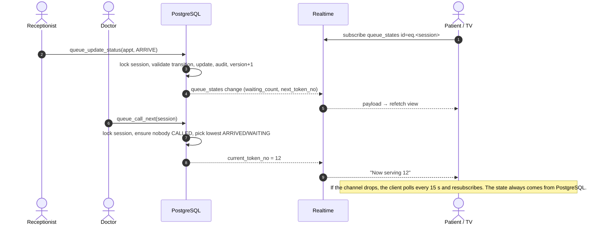

# 5. Sequence diagrams

## Free / pay-at-hospital booking

```mermaid
sequenceDiagram
    autonumber
    actor P as Patient browser
    participant A as Supabase Auth
    participant DB as PostgreSQL (book_token)
    participant RT as Realtime

    P->>A: signInAnonymously({ captchaToken }) (first booking on this device; token only if Turnstile is configured)
    A-->>P: session JWT (is_anonymous = true)
    P->>P: Zod validation; client_request_id = uuid()
    P->>DB: rpc book_token(shift, date, name, phone, age, client_request_id)
    DB->>DB: validate, resolve session, compute fee, rate limits
    DB->>DB: SELECT queue_states FOR UPDATE (serialize session)
    DB->>DB: duplicate + capacity re-check, token = last+1, INSERT appointment
    DB->>DB: refresh counters (version+1), audit, in-app notification
    DB-->>P: { booking_reference, access_key, token_no, ... }
    DB-->>RT: queue_states UPDATE (no PII)
    RT-->>P: other viewers see remaining capacity change
    P->>P: navigate /booking/MQ-XXXX#k=<key> (key only in URL fragment)
```

If the response is lost and the client retries with the same `client_request_id`, it gets the
same booking (`replayed: true`) and a rotated key. It never gets a second token.

## Online payment (Razorpay test mode; disabled by default)

```mermaid
sequenceDiagram
    autonumber
    actor P as Patient browser
    participant EF as Edge Functions
    participant DB as PostgreSQL
    participant RZ as Razorpay

    P->>EF: payments-create-order {booking fields, idempotency_key} + JWT
    EF->>EF: verify JWT, validate body, PAYMENTS_ENABLED?
    EF->>DB: svc_hold_paid_booking(user, ..., idempotency_key)
    DB-->>EF: PAYMENT_PENDING appointment (no token), amount from DB, needs_order
    EF->>RZ: POST /v1/orders {amount, receipt = booking_reference}
    RZ-->>EF: order_id
    EF->>DB: svc_attach_order(payment_id, order_id)
    EF-->>P: {key_id, order_id, amount, booking_reference, access_key}
    P->>RZ: Razorpay Checkout (card/UPI entered on Razorpay, never on our page)
    RZ-->>P: {payment_id, order_id, signature}
    Note over P: Browser success is NOT trusted
    P->>EF: payments-verify {order_id, payment_id, signature}
    EF->>EF: HMAC_SHA256(order_id|payment_id, key_secret) == signature (constant time)
    EF->>RZ: GET /v1/payments/{payment_id} (order, amount, status)
    EF->>DB: svc_confirm_payment(order_id, payment_id, amount, CHECKOUT_SIGNATURE)
    DB->>DB: lock session → appointment → payment; CAPTURED; token = last+1; CONFIRMED
    DB-->>EF: outcome CONFIRMED + token
    EF-->>P: token confirmed

    RZ->>EF: webhook payment.captured (X-Razorpay-Signature, x-razorpay-event-id)
    EF->>EF: HMAC over raw body with webhook secret
    EF->>DB: svc_process_payment_event(event_id, ...)
    DB->>DB: INSERT payment_events ON CONFLICT DO NOTHING (dedupe)
    DB-->>EF: ALREADY_CONFIRMED (or CONFIRMED if the browser never came back)
    EF-->>RZ: 200
```

Failure handling:

| Situation                               | Result                                                                                                                                                              |
| --------------------------------------- | ------------------------------------------------------------------------------------------------------------------------------------------------------------------- |
| Checkout dismissed / payment failed     | Appointment stays `PAYMENT_PENDING` until the hold expires (15 min default). The patient can retry on the same order or cancel the hold. No token, no confirmation. |
| Browser closed after paying             | The webhook confirms the booking, and the patient sees it in "My appointments".                                                                                     |
| Webhook delivered twice / concurrently  | The unique `gateway_event_id` lets only one delivery apply. The payment-level check makes `order.paid` + `payment.captured` idempotent too.                         |
| Webhook arrives late, after hold expiry | Confirms if capacity remains. Otherwise the appointment is cancelled and a refund is **requested** (not promised).                                                  |
| Payment for a cancelled booking         | Never restored to the queue. A refund request is recorded.                                                                                                          |
| Amount mismatch                         | Rejected and audited. The booking stays unconfirmed.                                                                                                                |
| Retry of create-order                   | Same idempotency key gives the same hold and the same order. A concurrent retry gets `409` until the first finishes.                                                |

## Staff queue (Realtime + polling fallback)


